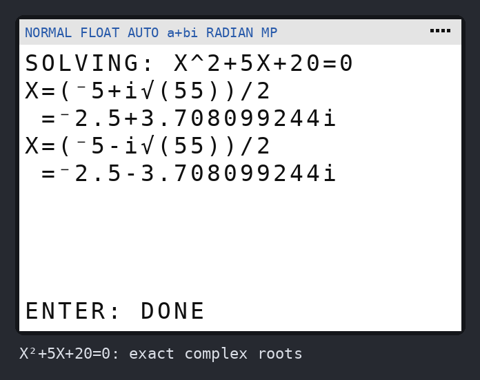
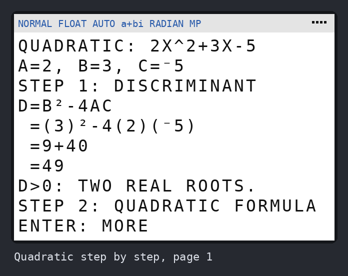
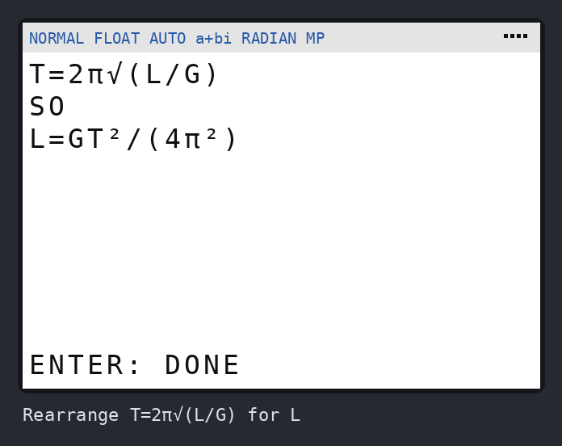
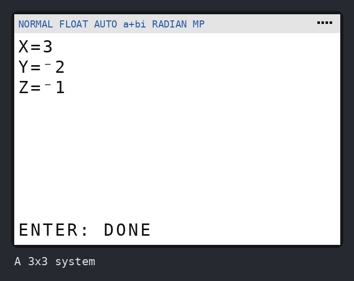
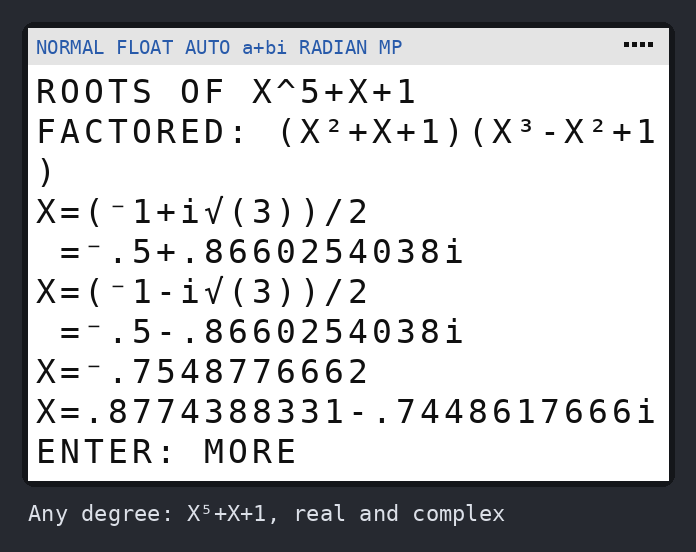

# Brainiac

A math solver for the **TI-84 Plus CE**. Version 0.2:

| | |
|---|---|
| **Solve for X** | Any equation. Polynomials get exact answers, including fractions, square roots, complex roots and repeated roots, with no range to pick. Anything else (sin, √, ln…) is searched from -99 to 99. |
| **Find zeros of F(X)** | The same engine, for a function instead of an equation. |
| **Polynomials** | Roots of any degree (complex too), **quadratic step by step** (discriminant, formula, factored form, vertex form), **simplify/expand**, **factor**, **divide**. |
| **System of equations** | Up to 6 linear equations, typed the way you'd write them. It says when there's no solution or infinitely many. |
| **Rearrange a formula** | `A=BH/2` for H gives `H=2A/B`. `T=2π√(L/G)` for L gives `L=GT²/(4π²)`. |
| **Inverse function** | `(X+1)/(X-2)` gives `F⁻¹(X)=(2X+1)/(X-1)`. |

| | | |
|---|---|---|
|  |  |  |
|  |  |  |

All the screenshots are in [`screenshots/`](screenshots/).

## Get it on your calculator

You need **one file**: [`dist/BRAINIAC.8xp`](dist/BRAINIAC.8xp)
([direct download](https://github.com/corruptchemist/stuff/raw/claude/brainiac-math-solver-mdgiwt/brainiac/dist/BRAINIAC.8xp)).

**It needs calculator OS 5.2 or newer.** To check, press **[2nd] [+]** (MEM)
and choose **About**. If your OS is older, TI Connect CE can update it
for free.

1. Install **TI Connect CE** from [education.ti.com](https://education.ti.com/en/products/computer-software/ti-connect-ce-sw).
2. Plug the calculator in with its USB cable and turn it on.
3. In TI Connect CE, open **Calculator Explorer**. Drag `BRAINIAC.8xp` onto
   your calculator, or use the **Send to Calculators** button, and click
   **Send**.
4. On the calculator press **[prgm]**, pick **BRAINIAC**, then press
   **[enter]** twice.

To update to a newer version, send the new file the same way. When it asks,
choose **Replace**.

## Using it

- **Type with capital letters.** X is the **[X,T,θ,n]** key. Other letters
  are **[alpha]** plus a key.
- `=` is in **[2nd] [math]** (TEST), item 1.
- Use the **[(-)]** key for negative numbers, not **[−]**.
- `(DOUBLE)` after an answer means a repeated root, where the graph touches
  zero without crossing it.
- Answers that run past one screen show **ENTER: MORE**.

### What it can't do yet

- Rearranging formulas with trig, logs, or a letter in an exponent, like
  `A=P(1+R)^T` for T. Brainiac says so rather than guessing.
- Solving for a letter that appears with two different powers, like X and X²
  in `Y=AX²+BX+C`. Use Solve for X with numbers instead.
- Formulas with more than 6 different letters.
- Factoring is over whole numbers and fractions. `X²-2` doesn't factor, but
  Polynomials > Roots gives `X=±√(2)`.

### Good to know

- Brainiac uses matrices **[I]** and **[J]** as scratch space. Anything
  stored in them gets overwritten.
- Trig uses your calculator's Radian/Degree setting.
- If you stop a search with **[on]**, or an error stops the program, the
  calculator is left in `a+bi` mode. Set it back with **[mode] → REAL**.
- Tests that put the calculator in **Press-to-Test** mode turn off all
  programs, Brainiac included.

## Try it without the calculator

`brainiac/` has a TI-BASIC simulator. It runs the same file the calculator
gets, on a pretend 26×10 screen. On Windows, double-click
**`brainiac-play.bat`**. Anywhere else:

```bash
pip install -r brainiac/requirements.txt
python -m brainiac.play            # play the .8xp
python -m brainiac.play --png out  # ...and save a picture of every screen
```

Type like you would on a computer: `x^2-4=0`, `sqrt(x)`, `pi`, `-5`.

## How it works

**Polynomials, exactly.** Brainiac works an expression out at 16 points on
a circle in the complex plane and runs a Fourier transform on those values.
That gives the polynomial's coefficients, and they snap to exact fractions
(and multiples of π). Two far-out check points catch anything that only
looks like a polynomial up close, like `sin(X)`, `√(X)` or `1/(X-3)`.

With several letters it does the same per letter on a small grid. That's how
`PV=NRT` becomes the numbers it needs to solve for T. Letters on the bottom,
like `V/I` or `1/F`, are handled by multiplying through first.

From the coefficients:

- **Roots and factoring.** It finds every fraction root P/Q and checks each
  one exactly, using whole-number arithmetic. It divides those out, then
  tries to split what's left into whole-number quadratics. Quadratics get
  exact square-root forms. Anything still left gets decimal roots from the
  Durand–Kerner method, which finds all complex roots at once.
- **Rearranging.** Once the formula is a polynomial, solving for a letter
  that appears with one power is just "everything else over its
  coefficient". After that come the tidying steps a person would do: clear
  fractions, cancel common factors, take squares out of square roots.

**Everything else, numerically.** It evaluates all 201 points of a sweep as
one list operation, then halves each sign change down to about 11 digits.
It runs in `a+bi` mode, so `√` of a negative gives a complex number, which
it skips, instead of an error. Asymptotes like `1/X` at 0 end on a huge
value and get dropped. Dips that only touch zero are found by narrowing in
on the lowest point. The sweep works out from the middle and stops on a side
before values get big enough to cause ERR:OVERFLOW.

## Working on it

| File | What it is |
|---|---|
| `src/BRAINIAC.txt` | The program: TI-BASIC with `//` notes, `@labels` and `#sub`/`#call` macros |
| `build.py` | `python -m brainiac.build` expands the macros, checks the code, and writes `dist/BRAINIAC.8xp` |
| `tibasic.py` | The simulator: a TI-BASIC interpreter covering what Brainiac uses |
| `play.py` / `screen.py` | Play in the terminal; draw screens as PNGs |
| `shots.py` | `python -m brainiac.shots` regenerates `screenshots/` |
| `../tests/test_brainiac.py` | `python -m pytest tests/test_brainiac.py` (133 tests) |

The build refuses two kinds of mistake that would only show up on the
calculator:

- **A `Goto`, `Menu(` or `#call` inside an If-Then or loop.** The calculator
  never closes a block it jumps out of, so each such jump leaks memory until
  ERR:MEMORY.
- **A list name followed by a bracket meant as multiplication.** `ʟBY(2πS)`
  means "item 2πS of list BY", not BY times 2πS.

The simulator copies the calculator's habits that usually break TI-BASIC
programs:

- the same errors (NONREAL ANS, DIVIDE BY 0, OVERFLOW, DOMAIN…);
- 14-digit decimal arithmetic;
- an `and` that checks both sides before deciding;
- a count of any jump out of a block.

Tests require that count to stay at zero.
