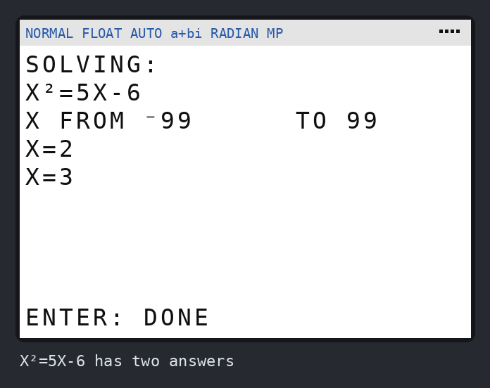
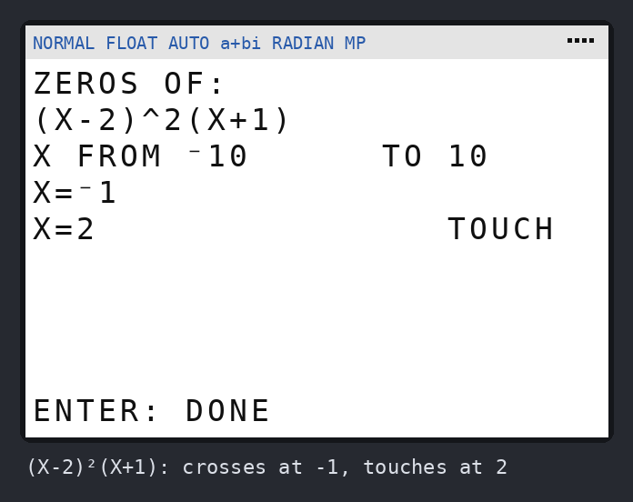

# Brainiac

A math solver for the **TI-84 Plus CE**. Version 0.1 does two things well:

- **Solve for X**: type any equation in X, such as `2X+3=7`, `X²=5X-6` or
  `X³-2X=5`, and get every solution. No guess needed.
- **Find all zeros**: type f(X) and a range, and get every X in that range
  where f(X)=0. It says which zeros the graph only **touches** (like the 2 in
  `(X-2)²`) rather than crosses.

| | | |
|---|---|---|
|  |  |  |

The calculator's own `solve(` gives you one answer near a guess and stops with
an error if the guess is bad. Brainiac sweeps the whole range, so it finds
every answer, and it is built to keep going where the built-in tools stop:

- **Asymptotes aren't zeros.** `1/X` and `tan(X)` change sign at their
  asymptotes, but Brainiac doesn't report those as zeros.
- **No errors outside the domain.** `√(X)` and `ln(X)` don't stop the
  program when the search goes below zero; those spots are skipped.
- **Close roots are found.** `X²-.0001` has zeros at ±0.01, closer together
  than the search steps, and both are found.
- **Flat roots come out clean.** `(X-1)³` shows `X=1`, not `1.000000143`.
- **Identities are spotted.** `X+1=1+X` shows "every X works".

## Get it on your calculator

You need **one file**: [`dist/BRAINIAC.8xp`](dist/BRAINIAC.8xp)
([direct download](https://github.com/corruptchemist/stuff/raw/claude/brainiac-math-solver-mdgiwt/brainiac/dist/BRAINIAC.8xp)).

**TI Connect CE is the right tool.** It is TI's own free app for Windows and
Mac, and the most reliable way to load a TI-84 Plus CE:

1. Install **TI Connect CE** from [education.ti.com](https://education.ti.com/en/products/computer-software/ti-connect-ce-sw).
2. Plug the calculator in with its USB cable and turn it on. Use the cable
   that came with it: some phone cables only charge and can't carry data.
3. In TI Connect CE, open **Calculator Explorer**. Your calculator shows up
   in the list.
4. Drag `BRAINIAC.8xp` onto the calculator, or use the **Send to
   Calculators** button, then click **Send**.
5. On the calculator press **[prgm]**, pick **BRAINIAC**, then press
   **[enter]** twice.

Optional: in **[2nd] [+] (MEM) → Mem Management → Prgm**, press
**[enter]** next to BRAINIAC to archive it (a ✱ appears). Archived programs
survive a RAM reset, and the CE still runs them normally.

The alternative, typing the program in by hand, is about 300 lines where one
wrong key breaks it. Sending the file is much better. When there's a new
version, send the new file the same way and let it replace the old one.

## Using it

**Solve for X:** press **1**, type an equation, press **[enter]**.

- `=` is under **[2nd] [math]** (TEST menu), item 1.
- X is the **[X,T,θ,n]** key, and negative numbers use **[(-)]**, not **[−]**.
- With no `=`, Brainiac solves `…=0`.
- It looks at X from -10 to 10 in fine steps, then -99 to 99 in coarser
  ones. For answers further out, use Find all zeros with your own range.
- Repeating equations like `sin(X)=.5` have a lot of answers in -99…99 (63
  of them). For just the ones you need, use Find all zeros with a smaller
  range, such as 0 to `2π`.

**Find all zeros:** press **2**, type f(X), then the range. Leave **FROM** and
**TO** blank for -10 to 10. You can type expressions such as `-2π` or `3π`.

**Results** show 6 per page. Press **[enter]** for more, then choose **AGAIN**,
**MAIN MENU** or **QUIT**. Each search takes a few seconds; the `=` bar shows
progress.

### Good to know

- Use **X** as the only letter in your equation. Brainiac uses the other
  letter variables for its own work.
- Brainiac uses **Y₀** as scratch space and clears it when you quit. If you
  had something saved in Y₀, copy it to another Y= slot first.
- Trig uses your calculator's **Radian/Degree** setting.
- For cube roots of negative numbers, use **[math] 4: ³√(**. Writing
  `X^(1/3)` has no real value below zero in the mode Brainiac uses.
- If you stop a search with **[on]**, or an error stops the program, the
  calculator is left in `a+bi` mode. Set it back with **[mode] → REAL**.
- Tests that put the calculator in **Press-to-Test** mode turn off all
  programs, Brainiac included.
- A typo in an equation stops with `ERR:SYNTAX`. Choose **1: Quit** and try
  again.
- A function that passes 10⁶⁰ (like `e^(X²)` beyond X≈12) isn't searched
  any further in that direction. This keeps the calculator away from
  ERR:OVERFLOW.

## Try it without the calculator

`brainiac/` also has a TI-BASIC simulator. It runs the same file the
calculator gets, on a pretend 26×10 home screen, so you can try Brainiac (or
an edit to it) on a PC. On Windows, double-click **`brainiac-play.bat`** in
the repo folder. Anywhere else:

```bash
pip install -r brainiac/requirements.txt
python -m brainiac.play            # play the .8xp
python -m brainiac.play --png out  # ...and save a picture of every screen
```

Type like you would on a computer: `x^2-4=0`, `sqrt(x)`, `pi`, `-5`.

## Working on it

| File | What it is |
|---|---|
| `src/BRAINIAC.txt` | The program, as TI-BASIC text. `//` lines are notes. |
| `build.py` | `python -m brainiac.build` turns the source into `dist/BRAINIAC.8xp`, using the [TI-Toolkit](https://github.com/TI-Toolkit/tivars_lib_py) token tables |
| `tibasic.py` | The simulator: a TI-BASIC interpreter covering what Brainiac uses |
| `play.py` / `screen.py` | Play in the terminal; draw screens as PNGs |
| `shots.py` | `python -m brainiac.shots` regenerates `screenshots/` |
| `../tests/test_brainiac.py` | `python -m pytest tests/test_brainiac.py` |

After editing the source, run `python -m brainiac.build`. A test checks that
`dist/BRAINIAC.8xp` matches the source, so a stale file can't slip through.

The simulator copies the calculator's habits that usually break TI-BASIC
programs: ERR:NONREAL ANS, ERR:DIVIDE BY 0 and ERR:OVERFLOW stop the program
just as they would on the calculator. It also counts the memory leak that
happens when a `Goto` jumps out of an `If-Then` or loop, and the tests require
that count to stay at zero.

### How the zero finder works

1. **Sweep.** It evaluates f at 201 points across the range, working
   outward from the middle. The points are offset slightly from round
   numbers so that 1/X never lands exactly on X=0. It runs in `a+bi` mode,
   so √ of a negative gives a complex number, which it skips, instead of
   stopping the program. If |f| passes 10⁶⁰, it stops going in that
   direction, before ERR:OVERFLOW can happen.
2. **Crossings.** Neighbouring points with opposite signs trap a zero.
3. **Touches and close pairs.** Where |f| dips toward zero without changing
   sign, a parabola through the three points estimates how low the dip goes.
   If it might reach zero, that stretch is rescanned 24× finer to find
   crossings. If there are none, it narrows in on the lowest point and keeps
   it if f really is 0 there. That point is a **touch**.
4. **Narrowing.** Each trapped zero is halved down to about 12 digits. If f is
   huge where it ends up, the sign change was an asymptote, so it's dropped.
5. **Tidying.** Answers are sorted and duplicates are removed. Each answer
   becomes its shortest rounding (2, then 2.1, then 2.14…) that fits the
   equation at least as well as the raw answer.
