# Brainiac

A math solver for the **TI-84 Plus CE**, in three programs. Version 0.5 (test builds), on top of 0.4:

**BRAINIAC** (algebra)

| | |
|---|---|
| **Solve for X** | Any equation. Polynomials get exact answers (fractions, square roots, complex roots, repeated roots), with no range to pick. **Absolute value** equations are split into their two cases, **radical** equations are squared with the extraneous roots caught, **rational** equations are multiplied through with values that make a bottom 0 caught. **Exponential** equations take logs (`2^(X+1)=8^(X-1)`, `e^(2X)=7`), **log** equations raise 10 or e to both sides and check every answer (`log(X)+log(X-3)=1` gives X=5, not ⁻2). When the hard part has numbers around it, like `5(2^X)=40` or `3ln(X)-1=5`, it first gets that part alone. Anything else is searched from -99 to 99 (0 to 360 for trig in Degree mode). |
| **Inequalities** | Type `<`, `>`, `≤` or `≥` instead of `=`: `2X+3>7`, `X²-4<0`, `abs(X-1)<3`, `log(X)<2`. A **number line** comes first (filled dots included, open dots not), then the working: the boundary points, a test point in each part, and the answer in **interval notation**, like `(-INF,⁻2]U[2,INF)`, plus `⁻2<X<2` for a single interval. Where a log or square root starts counts as a boundary, so `log(X)<2` gives `(0,100)`. |
| **Help me choose** | Not sure which tool? It asks what you have (an equation, an inequality, an expression, a formula, several equations, a shape) and what you need, and takes you there. |
| **Polynomials** | Roots of any degree (complex too), **quadratic steps + forms** (any form in: standard, factored and vertex forms out, with the discriminant, the formula, the vertex and the sum and product of the roots), **simplify/expand**, **factor**, **divide**, **zeros of F(X)**. |
| **System of equations** | Up to 6 linear equations, typed the way you'd write them. It says when there's no solution or infinitely many. |
| **Formulas** | **Rearrange**: `A=BH/2` for H gives `H=2A/B`, `T=2π√(L/G)` for L gives `L=GT²/(4π²)`, `R=1/(1/A+1/B)` for A gives `A=⁻BR/(R-B)`. **Inverse**: `(X+1)/(X-2)` gives `F⁻¹(X)=(2X+1)/(X-1)`, `1/(X+2)+3` gives `(⁻2X+7)/(X-3)`, `√(X)+1` gives `X²-2X+1`, `³√(X-1)+2` gives `X³-6X²+12X-7`. |

**GEOMETRY** (every solver first draws the figure with letters on it, so you
can see which side or angle each prompt means; then asks for the values;
then draws it again with your numbers and shows the working)

| | |
|---|---|
| **Triangles** | Missing angle; Pythagorean theorem; 45-45-90 and 30-60-90 triangles; trig (SOH CAH TOA) for a side or an angle; similar triangles. |
| **Angles & lines** | Triangle angles; intersecting lines; parallel lines cut by a transversal (all eight angles). |
| **2D shapes** | Area and perimeter of triangles (3 sides, or base and height), rectangles, circles, trapezoids, and combined shapes built by adding and taking away parts. |
| **3D solids** | Volume and surface area of boxes, cylinders, cones, spheres and square pyramids. |
| **Circles** | Radius, diameter, circumference or area from any one of them; arc length, sector area and chord; circle equations both ways (center and radius ↔ standard and general form). |
| **Scale factors** | How a factor K changes lengths, area and volume. |

**UNITS** (unit conversion, shown as dimensional analysis: the amount
times fractions that each equal 1, so the old units cancel)

| | |
|---|---|
| **Length, mass, volume, area, time** | Metric and US units, numbered on one screen. Every fraction is one a student knows: `5 MI ×5280 FT/1 MI ×12 IN/1 FT ×2.54 CM/1 IN ×1 M/100 CM ×1 KM/1000 M =8.04672 KM`. Each unit hangs off a bigger or smaller one (MI→FT→IN, GAL→QT→PT→CUP→FL OZ→TBSP→TSP, YEAR→DAY→HR→MIN→SEC); US and metric meet at one exact link (1 IN = 2.54 CM, 1 LB = 453.59237 G, 1 GAL = 3.785411784 L, 1 IN² = 6.4516 CM²). |
| **Rates** | A unit over a unit: `60 MI/HR ×5280 FT/1 MI ×1 HR/60 MIN ×1 MIN/60 SEC =88 FT/SEC`, density in G/ML, fuel use in MI/GAL. |
| **Temperature** | °F, °C and K, with the formulas worked through, and a warning below absolute zero. |

| | | |
|---|---|---|
| 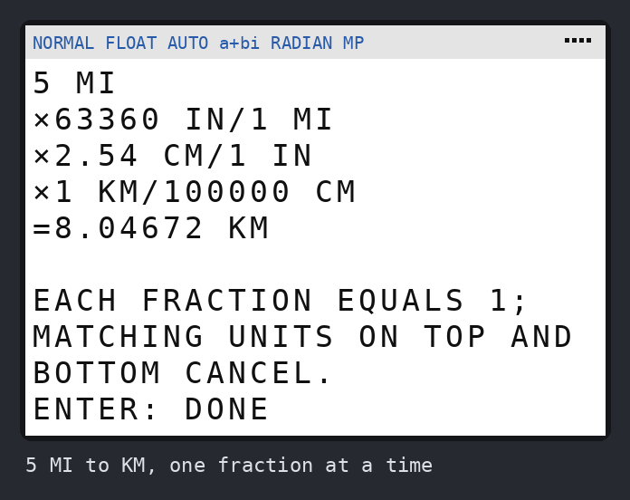 | 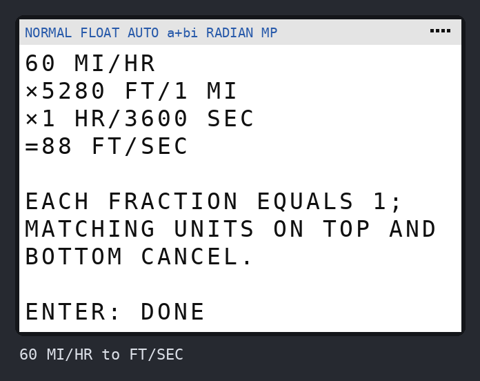 | 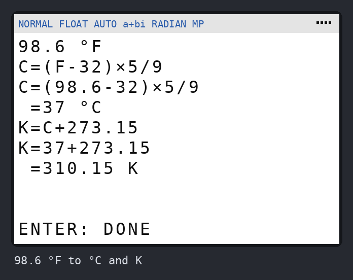 |
| 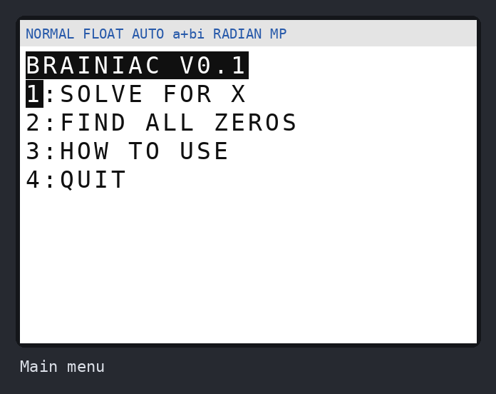 | 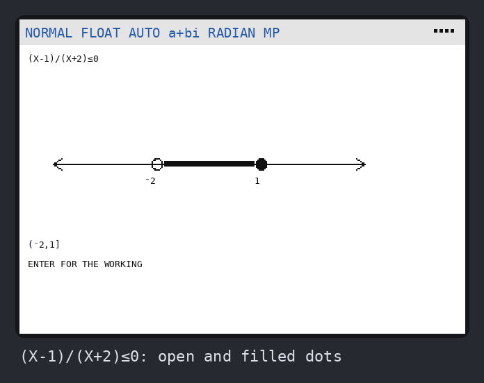 | 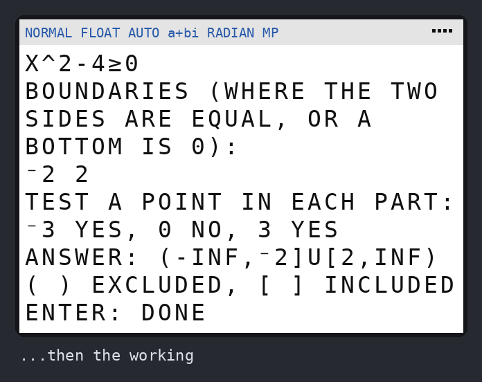 |
| 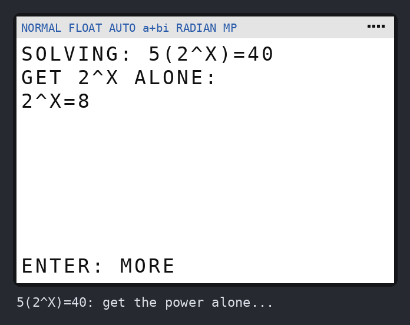 | 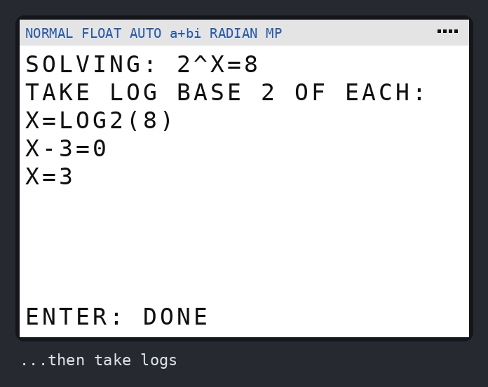 | 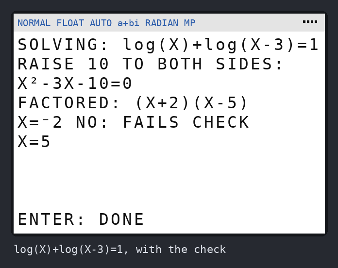 |
| 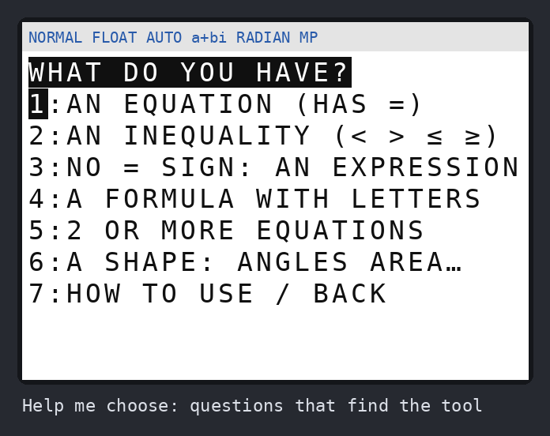 | 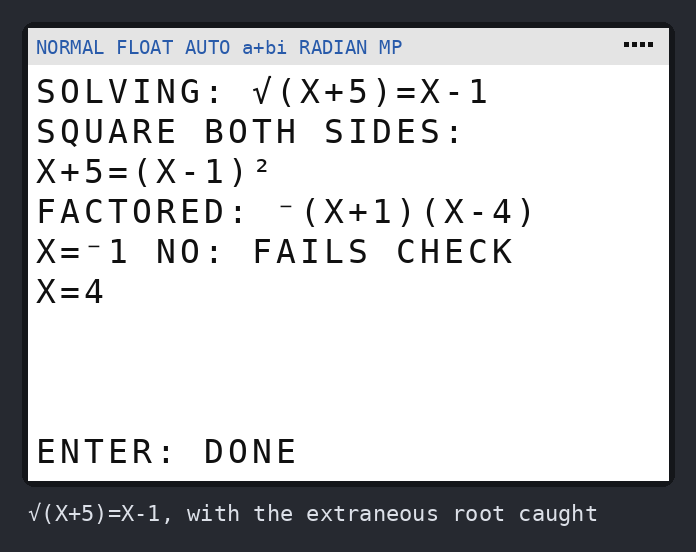 | 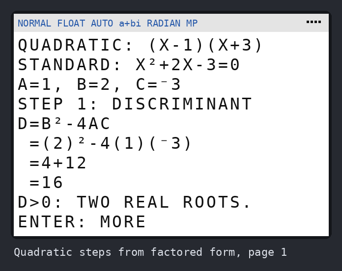 |
| 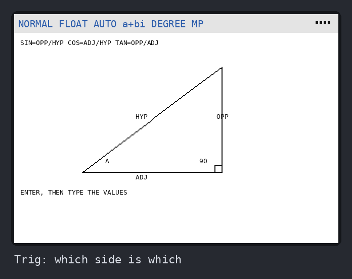 | 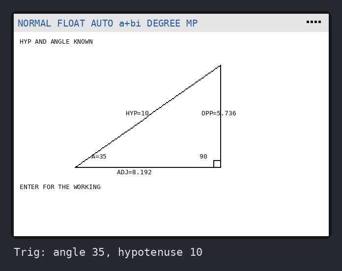 | 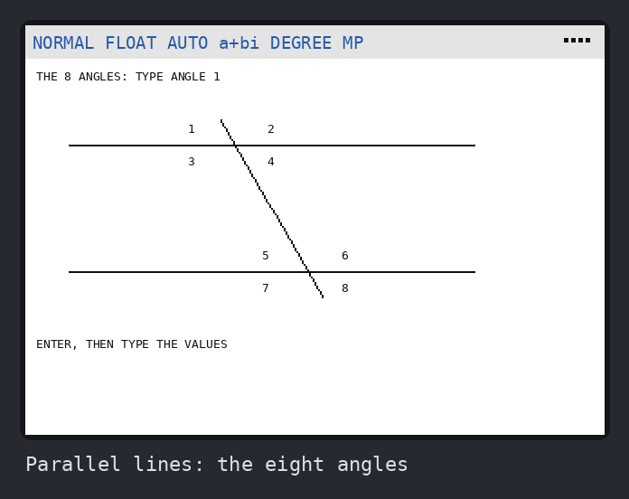 |
| 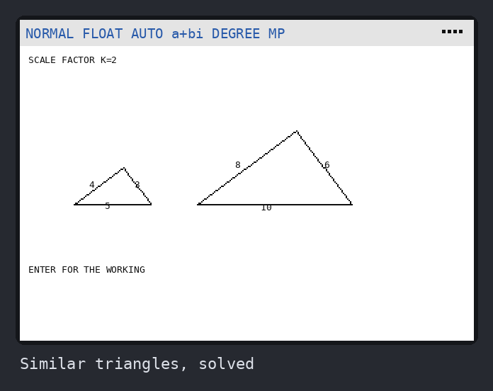 | 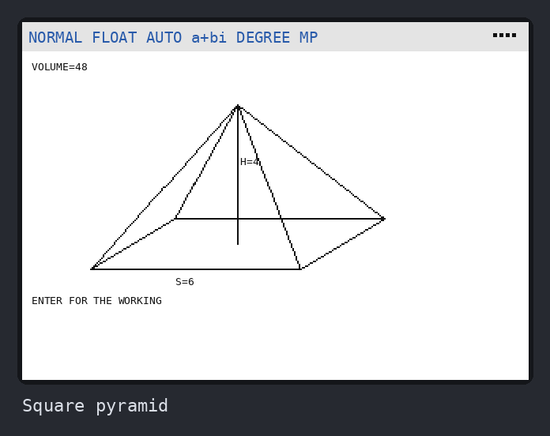 | 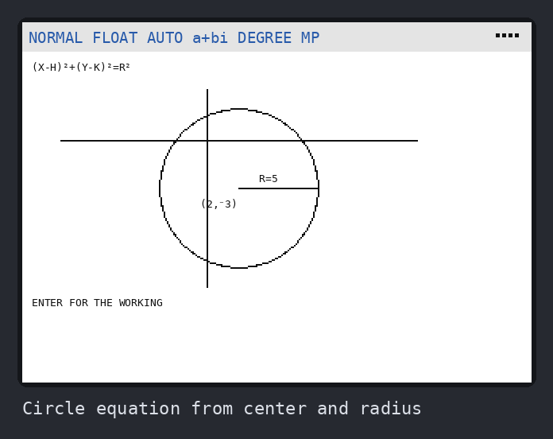 |

All 60 screenshots are in [`screenshots/`](screenshots/).

## Get it on your calculator

There are two sets of three files. Send whichever you want; both sets can
be on the calculator at once.

| | Stable (last version tried on a real calculator) | Test (newest, not yet tried on a calculator) |
|---|---|---|
| Algebra | [`BRAINIAC`](dist/BRAINIAC.8xp) | [`BRAINUNS`](dist/BRAINUNS.8xp) |
| Geometry | [`GEOMETRY`](dist/GEOMETRY.8xp) | [`GEOMUNS`](dist/GEOMUNS.8xp) |
| Units | [`UNITS`](dist/UNITS.8xp) | [`UNITSUNS`](dist/UNITSUNS.8xp) |

The test set runs only the test set: BRAINUNS's menu opens GEOMUNS and
UNITSUNS, and its title says `BRAINIAC 0.5 TEST`. So if a test build
misbehaves, the stable one is still there. (TI program names are at most 8
letters, hence the short names.) Once a test build has been tried,
`python -m brainiac.build --stable` turns it into the stable one.

Brainiac's GEOMETRY & UNITS menu item runs the other two; they also run on
their own from **[prgm]**. They are separate because a TI-BASIC `Goto` scans
the program from the top, so one big program would make all of them slower.

**It needs calculator OS 5.2 or newer.** To check, press **[2nd] [+]** (MEM)
and choose **About**. If your OS is older, TI Connect CE can update it
for free.

1. Install **TI Connect CE** from [education.ti.com](https://education.ti.com/en/products/computer-software/ti-connect-ce-sw).
2. Plug the calculator in with its USB cable and turn it on.
3. In TI Connect CE, open **Calculator Explorer**. Drag the three `.8xp` files
   onto your calculator, or use the **Send to Calculators** button, and click
   **Send**.
4. On the calculator press **[prgm]**, pick **BRAINIAC** (or **BRAINUNS**),
   then press **[enter]** twice.

To update to a newer version, send the new file the same way. When it asks,
choose **Replace**.

## Using it

- **Type with capital letters.** X is the **[X,T,θ,n]** key. Other letters
  are **[alpha]** plus a key.
- `=` is in **[2nd] [math]** (TEST), item 1. `<` `>` `≤` `≥` are in the
  same menu.
- `log(` is the **[log]** key, `ln(` is **[ln]**, `𝑒^(` is **[2nd] [ln]**
  and `10^(` is **[2nd] [log]**. `2^X` is `2` **[^]** `X`.
- Use the **[(-)]** key for negative numbers, not **[−]**.
- `(DOUBLE)` after an answer means a repeated root, where the graph touches
  zero without crossing it.
- There's no way to leave a prompt blank. If you change your mind, type
  anything (like `1`) and pick MAIN MENU afterwards.
- Geometry works in degrees and draws on the graph screen. It puts your
  window, axes, grid, Y= functions and angle mode back the way they were
  when you leave it through its menu (not if you stop it with **[on]**).
  To do that it borrows graph database **GDB9** (and deletes it after).
- All three programs switch the calculator to **Normal**, **Float** and
  **Full** screen mode, because Fix, Sci or a split screen would garble
  their answers.
- A typing slip that would stop the program, like a `)` with nothing to
  close or dividing by 0, gets a message and you type it again.
- Trig of something that can turn imaginary, like `sin(√(X))=.5`, and
  `sin⁻¹(`/`cos⁻¹(` of something that can pass ±1 are worked out only where
  they are real numbers (they used to stop with ERR:DATA TYPE or DOMAIN).
  `sin⁻¹(X)≥0` gives [0,1].
- Geometry refuses an imaginary number (when Brainiac runs it, `a+bi` is on)
  or one of 10^12 or more, and asks again.
- Answers that run past one screen show **ENTER: MORE**.
- **Degree or Radian, your choice.** Brainiac does its own math in Radian
  (the TI-84 Plus CE refuses some complex-number math in Degree mode, which
  is what made Simplify fail with ERR:DOMAIN in 0.3). Only `sin(`, `cos(` and
  `tan(` that you type take your mode: in Degree, `sin(X)=.5` gives 30 and
  150. Brainiac turns those degrees into radians itself, so trig mixed with
  logs or roots, like `sin(X)+log(X)=1`, works in Degree too. Quitting
  through the menu puts your mode back.

### What it can't do yet

- Rearranging formulas with trig, logs, or a letter in an exponent, like
  `A=P(1+R)^T` for T. Brainiac says so rather than guessing.
- Absolute-value, radical, exponential and log equations get the textbook
  treatment when the `abs(`, `√(`, power or log is the only place the letter
  is, like `2abs(X-1)+3=7`. Something like `abs(X)+1=X²` or `2^X=X+3` still
  gets solved, by the numeric search.
- Trig inequalities in Degree mode are answered for one turn, 0 to 360.
- Solving for a letter that appears with two different powers, like X and X²
  in `Y=AX²+BX+C`. Use Solve for X with numbers instead.
- Formulas with more than 6 different letters.
- Units: a year is 365 days, a ton is 2000 LB, cups and gallons are US.
- Factoring is over whole numbers and fractions. `X²-2` doesn't factor, but
  Polynomials > Roots gives `X=±√(2)`. It finds factors of degree 1 and 2,
  so a product of two cubics like `(X³+2)(X³+3)` is left as it is.
- Polynomials up to degree 14 in one letter, or 6 per letter with several
  letters. Powers of 100 or more are refused before they overflow.
- Numbers more than about a billion times apart in one problem (like
  `X²=10000000000`) lose the small one: the calculator keeps 14 digits.
- Polynomials of degree 5 or more with decimals and roots close together,
  like `(X-1.1)(X-2.2)…(X-7.7)=0`, get their roots right to about 6 digits
  (`X=5.500005604`), and a repeated root among them can show a tiny 𝑖 part
  (`X=⁻3.1+9.95ᴇ⁻6𝑖`).
- Inequalities find boundaries between ⁻99 and 99 (holes from a bottom
  between ⁻9999 and 9999). A point where the expression has no value but
  is fine on both sides, like X=0 in `ln(X²)<1`, isn't left out.
- Something that only gives an error by itself, like `0^0`, `ln(0)` or a
  number past 1ᴇ99, still stops the program: TI-BASIC can't catch errors.
- **SEARCH A RANGE** far from 0 with something that grows fast, like
  `2^X=X+3` from 0 to 1000000, can still pass 1ᴇ99 between two of its points
  and stop with ERR:OVERFLOW. Keep the range where the values stay sensible.
- The numeric search looks at 201 points across the range. It can miss
  answers of something that wiggles fast (like `tan(3X)=.2` across ⁻99..99)
  and some places where the graph only touches 0 (like `cos(X)=1` at the
  ends of 0..360). **SEARCH A RANGE** with a smaller range finds them.
- Very small answers, like 10^⁻10 for `-log(X)=10`, come out a few digits
  short (`9.9995ᴇ⁻11`).
- Simplify/Factor of a power that grows very slowly, like `e^(X/50)`, can
  be taken for a polynomial and shown as a series of tiny decimals.
  (Fractions and roots like `1/(X+60)` or `√(X+150)` are checked far out and
  refused; powers aren't, because far out they would overflow.)

### Good to know

- Brainiac uses matrices **[I]** and **[J]** as scratch space. Anything
  stored in them gets overwritten.
- If you stop a search with **[on]**, or an error stops the program, the
  calculator is left in `a+bi` and Radian mode. Set it back in **[mode]**.
- The test builds were checked by nine automated testers on the simulator:
  about 30,000 problems against an independent maths checker, every menu,
  and 10,000 typos (see `stress/`). The simulator is now as strict as the
  calculator in every way we know of, but it isn't the calculator, so try
  the test builds before relying on them in class.
- Tests that put the calculator in **Press-to-Test** mode turn off all
  programs, Brainiac included.

## Try it without the calculator

`brainiac/` has a TI-BASIC simulator. It runs the same file the calculator
gets, on a pretend 26×10 screen. On Windows, double-click
**`brainiac-play.bat`**. Anywhere else:

```bash
pip install -r brainiac/requirements.txt
python -m brainiac.play            # play the .8xp
python -m brainiac.play --png out  # ...and save a picture of every screen
```

Type like you would on a computer: `x^2-4=0`, `sqrt(x)`, `pi`, `-5`.

## How it works

**Polynomials, exactly.** Brainiac works an expression out at 16 points on
a circle in the complex plane and runs a Fourier transform on those values.
That gives the polynomial's coefficients, and they snap to exact fractions
(and multiples of π). Two far-out check points catch anything that only
looks like a polynomial up close, like `sin(X)`, `√(X)` or `1/(X-3)`.

With several letters it does the same per letter on a small grid. That's how
`PV=NRT` becomes the numbers it needs to solve for T. Letters on the bottom,
like `V/I` or `1/F`, are handled by multiplying through first.

From the coefficients:

- **Roots and factoring.** It finds every fraction root P/Q and checks each
  one exactly, using whole-number arithmetic. It divides those out, then
  tries to split what's left into whole-number quadratics. Quadratics get
  exact square-root forms. Anything still left gets decimal roots from the
  Durand–Kerner method, which finds all complex roots at once.
- **Rearranging.** Once the formula is a polynomial, solving for a letter
  that appears with one power is just "everything else over its
  coefficient". After that come the tidying steps a person would do: clear
  fractions, cancel common factors, take squares out of square roots.

**Everything else, numerically.** It evaluates all 201 points of a sweep as
one list operation, then halves each sign change down to about 11 digits.
It runs in `a+bi` mode, so `√` of a negative gives a complex number, which
it skips, instead of an error. Asymptotes like `1/X` at 0 end on a huge
value and get dropped. Dips that only touch zero are found by narrowing in
on the lowest point. The sweep works out from the middle and stops on a side
before values get big enough to cause ERR:OVERFLOW.

**Inequalities.** The boundary points are the equation's answers (found the
same way as Solve), the places where a bottom is 0, and the places where a
log or square root starts. Those last ones are found by halving on "is this
still a real number?". One test point in each part between the boundaries
decides which parts are in. Ends that are boundaries are included when the
sign allows equality and the expression has a value there.

**Getting the hard part alone.** For `5(2^X)=40`, Brainiac swaps `2^X` for
a stand-in, checks at three values that the rest is a straight line in it,
and solves that line: `2^X=8`. Then logs finish the job.

## Working on it

| File | What it is |
|---|---|
| `src/BRAINIAC.txt`, `src/GEOMETRY.txt`, `src/UNITS.txt` | The programs: TI-BASIC with `//` notes, `@labels` and `#sub`/`#call` macros |
| `build.py` | `python -m brainiac.build` expands the macros, checks the code, and writes every `dist/*.8xp` |
| `tibasic.py` | The simulator: a TI-BASIC interpreter covering what the programs use, graph screen included |
| `play.py` / `screen.py` | Play in the terminal; draw screens as PNGs |
| `shots.py` | `python -m brainiac.shots` regenerates `screenshots/` |
| `../tests/test_brainiac.py`, `test_geometry.py`, `test_units.py` | `python -m pytest tests/test_brainiac.py tests/test_geometry.py tests/test_units.py` (470+ tests) |

The build refuses two kinds of mistake that would only show up on the
calculator:

- **A `Goto`, `Menu(` or `#call` inside an If-Then or loop.** The calculator
  never closes a block it jumps out of, so each such jump leaks memory until
  ERR:MEMORY.
- **A list name followed by a bracket meant as multiplication.** `ʟBY(2πS)`
  means "item 2πS of list BY", not BY times 2πS.

The simulator copies the calculator's habits that usually break TI-BASIC
programs:

- the same errors (NONREAL ANS, DIVIDE BY 0, OVERFLOW, DOMAIN…);
- 14-digit decimal arithmetic;
- an `and` that checks both sides before deciding;
- **no empty strings**: `""→Str1` is ERR:INVALID DIM on the calculator
  (the bug that broke every mode of the first 0.2 build);
- `Text(` rows only go to 150 (row 152 was ERR:DOMAIN on the 0.4 number
  line);
- **no complex `𝑒^(` in Degree mode**: ERR:DOMAIN, the bug that broke
  Simplify in 0.3;
- `Menu(` takes at most 7 options;
- a label must be plain letters and digits (`FV` and `PV` are finance
  variables, so `Lbl FV` is ERR:SYNTAX);
- a count of any jump out of a block.

It also refuses things whose behaviour on the calculator isn't documented,
so Brainiac can't depend on them by accident: `seq(` producing complex
values, `augment(` of complex lists, storing a complex number into one
element of a real list, and comparing complex numbers (which really is
ERR:DATA TYPE). Brainiac builds its complex lists only by whole-list
arithmetic, which is documented.

Tests require the leak count to stay at zero.
